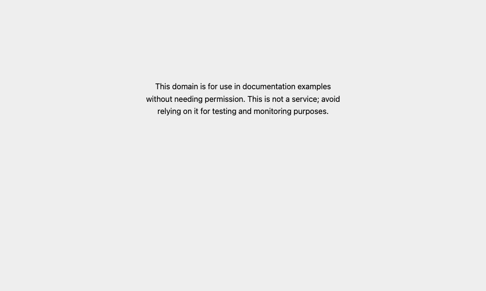

# DummySite CRD and controller

A `DummySite` resource has one property, `website_url`. The controller makes a copy of that page and serves it.

- `manifests/resourcedefinition.yaml`: the CustomResourceDefinition `dummysites.stable.dwk` (short name `dsite`).
- `manifests/serviceaccount.yaml`, `clusterrole.yaml`, `clusterrolebinding.yaml`: the controller may watch DummySites and create Deployments, Services and Ingresses.
- `manifests/deployment.yaml`: the controller (`controller/index.js`, Node.js, calls the Kubernetes REST API directly).

For each DummySite the controller creates, in the namespace of the DummySite:

- a Deployment: an init container downloads `website_url` with curl into an `emptyDir`, and nginx serves it
- a Service
- an Ingress for the host `<name>.localhost` (open http://example.localhost:8081)

The created objects have an owner reference to the DummySite, so deleting the DummySite deletes them.

## Run

```sh
docker build -t felixwickholm/dummysite-controller:5.1 controller
docker push felixwickholm/dummysite-controller:5.1
# role, account and binding (and the CRD)
kubectl apply -f manifests/resourcedefinition.yaml -f manifests/serviceaccount.yaml -f manifests/clusterrole.yaml -f manifests/clusterrolebinding.yaml
# controller
kubectl apply -f manifests/deployment.yaml
# DummySite
kubectl apply -f dummysite.yaml
kubectl get dsite
curl http://example.localhost:8081/
```

`dummysite-wikipedia.yaml` copies https://en.wikipedia.org/wiki/Kubernetes (served at http://kubernetes-wiki.localhost:8081, the CSS is broken).


