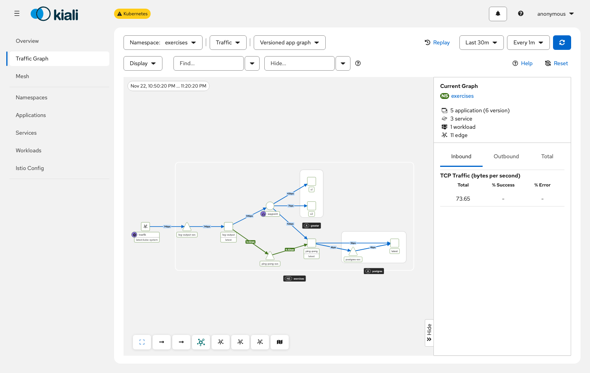

# Greeter (Log output, the Service Mesh Edition)

Exercise 5.3. `GET /` responds with a greeting. [Log output](../log_output) calls `greeter-svc` and shows the greeting with the rest of its output:

```
file content: this text is from file
env variable: MESSAGE=hello world
2026-11-22T21:17:56.721Z: 31649722-70f1-48a2-8416-442352e7a4bd.
Ping / Pongs: 6
greetings: Hello from greeter v1
```

## Mesh setup

- The namespace `exercises` is in the Istio ambient mesh and uses the waypoint `manifests/waypoint.yaml` (labels in `../log_output/manifests/namespace.yaml`). Istio itself is installed as in [istio](../istio).
- Two versions run from the same image with a different `GREETING`: `greeter-v1` ("Hello from greeter v1") and `greeter-v2` ("Moi from greeter v2").
- Three Services: `greeter-svc` (both versions), `greeter-svc-1` (v1) and `greeter-svc-2` (v2).
- The HTTPRoute `manifests/httproute.yaml` has `greeter-svc` as its parent and sends 75 % of the traffic to `greeter-svc-1` and 25 % to `greeter-svc-2`.

Check: 100 requests to Log output gave 71 × v1 and 29 × v2. Prometheus (`istio_requests_total`, reporter waypoint) counted 226 requests to v1 and 75 to v2.

Kiali (graph with waypoint proxies shown): Log output → waypoint → greeter v1 and v2:



## Run

ArgoCD deploys this directory together with Log output (`../log_output/kustomization.yaml` includes it). Without ArgoCD:

```sh
docker build -t felixwickholm/greeter:5.3 .
docker push felixwickholm/greeter:5.3
kubectl apply -k ../log_output
for i in $(seq 1 100); do curl -s localhost:8081/status | grep greetings; done | sort | uniq -c
```
