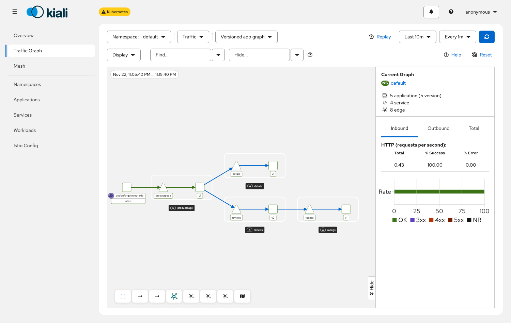

# Istio service mesh (ambient mode)

Exercise 5.2: Istio ambient mode on the k3d cluster, with the Bookinfo sample app. I followed the Istio "Getting started" guide up to "Clean up".

## Install

```sh
# Gateway API CRDs (the experimental "XBackend" CRD needs a newer Kubernetes than k3d's 1.31; the rest install fine)
kubectl apply --server-side -f https://github.com/kubernetes-sigs/gateway-api/releases/download/v1.6.1/experimental-install.yaml
# Istio 1.32.0, ambient profile, k3d platform settings
istioctl install --set profile=ambient --set values.global.platform=k3d --skip-confirmation
```

## Steps done (files in this directory)

1. **Deploy the sample app:** Bookinfo (`samples/bookinfo/platform/kube/bookinfo.yaml`, `bookinfo-versions.yaml`) and the Gateway API gateway (`samples/bookinfo/gateway-api/bookinfo-gateway.yaml`, annotated as ClusterIP). `kubectl port-forward svc/bookinfo-gateway-istio 8080:80` shows "Simple Bookstore App".
2. **Secure and visualize:** `kubectl label namespace default istio.io/dataplane-mode=ambient`. Kiali (`kiali.yaml`) uses the Prometheus of this cluster: `url: http://prom-prometheus-server.monitoring:80`.
3. **Enforce authorization policies:**
   - L4 policy `productpage-ztunnel.yaml`: only the gateway (and later the waypoint) may call productpage. The `curl` pod got exit code 56.
   - Waypoint: `istioctl waypoint apply --enroll-namespace --wait`.
   - L7 policy `productpage-waypoint.yaml`: the `curl` service account may send GET only. Results: `DELETE` from curl gives `RBAC: access denied`, GET from `reviews-v1` gives `RBAC: access denied`, GET from curl returns `<title>Simple Bookstore App</title>`.
4. **Manage traffic:** `reviews-90-10.yaml` sends 90 % of reviews traffic to v1 and 10 % to v2. 100 requests from the curl pod gave 87 % v1 and 13 % v2.

Kiali traffic graph of the namespace:


