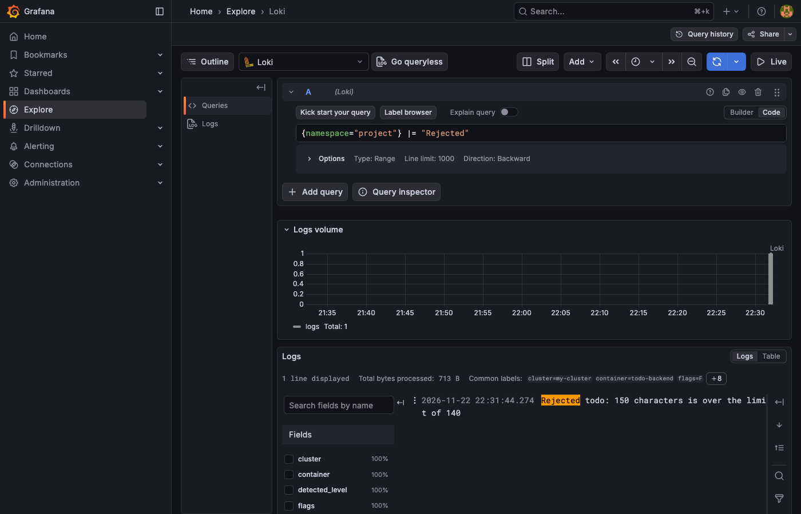

# Monitoring

Prometheus, Loki, Alloy (k8s-monitoring chart) and Grafana, installed with Helm into the namespace `monitoring`. The values files follow the course material, with two changes so the stack fits a local k3d cluster:

- `loki-values.yaml` disables the chunks and results caches (the chunks cache asks for more memory than the nodes have).
- `prom-values.yaml` also disables the Prometheus pushgateway subchart.
- `grafana-values.yaml` has no admin password; the chart generates one into the Secret `grafana`.

## Run

```sh
./install.sh
kubectl get pods --namespace monitoring
kubectl -n monitoring get secret grafana -o jsonpath='{.data.admin-password}' | base64 -d; echo
kubectl port-forward --namespace monitoring svc/grafana 3000:80
# open http://localhost:3000, log in as admin
```

In Explore, pick Loki and query `{namespace="project"} |= "Rejected"` to see todos that the backend blocked (exercise 2.10):


